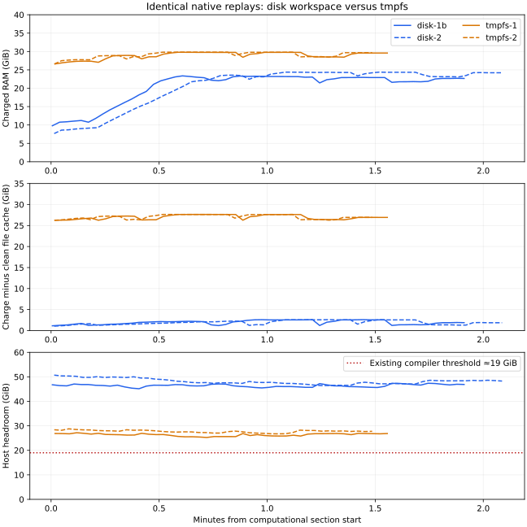

# Disk-backed native workspace: remove the persistent RAM floor

For a fleet that is continually memory constrained, **use a disk-backed native
workspace rather than tmpfs**. Four matched offline replays on chungus2 show that
the tmpfs workspace holds approximately 26 GiB after useful work has finished,
whereas disk-backed instances can return almost all their charge while retaining
the workspace. Tmpfs saves some elapsed time when there is spare RAM; that does
not justify its persistent footprint under the operator's stated constraint.

This experiment supports the storage choice, not a measured runner-count or
fleet-throughput multiplier. No production configuration or runtime package was
changed. The recommended next implementation is a bounded disk-backed workspace
with efficient usage monitoring, preserving the existing compiler policy.

## Four primary attempts

The balanced order was disk-1b, tmpfs-1, tmpfs-2, disk-2. All four passed the same
checks with byte-identical consumed inputs. All recorded **zero RAM-related
compiler wait, memory-max events, OOMs and OOM kills**. Other host work remained
enabled; this series had enough headroom for both storage modes to progress.

| Pass | Timed body | Unit RAM peak | Mean charge | Mean charge minus clean host file cache | Body CPU seconds | Host block reads |
| --- | ---: | ---: | ---: | ---: | ---: | ---: |
| disk-1b | 1m56.61s | 23.40 GiB | 20.51 GiB | **1.95 GiB** | 131.0 | 17.47 GiB |
| tmpfs-1 | 1m34.01s | 29.79 GiB | 28.94 GiB | **27.02 GiB** | 96.1 | 4.81 GiB |
| tmpfs-2 | 1m30.35s | 30.13 GiB | 29.12 GiB | **27.09 GiB** | 95.3 | 2.66 GiB |
| disk-2 | 2m05.93s | 24.41 GiB | 20.59 GiB | **1.92 GiB** | 139.0 | 20.78 GiB |

The clean-file discount is the existing Fleet proxy:
`current - max(0, file - shmem - file_dirty - file_writeback)`.
It is not an exact irreclaimable working set; it still includes reclaimable kernel
memory. Disk does **not** use only 2 GiB in total: its approximately 20.5 GiB mean
charge includes cache that other work can reclaim. Sampled peaks after the
clean-file discount were 2.60/2.59 GiB disk versus 27.64/27.66 GiB tmpfs.
Mean tmpfs shmem was 25.25 GiB in both controls; disk shmem was zero.



## Actual reclamation while the instance remains alive

After each timed body and completion hook, the job waits for a diagnostic probe.
The host requests `32G swappiness=0` through **only that experimental cgroup's**
`memory.reclaim`, captures before/after counters, then releases the job. No global
cache flush, host sysctl change, added memory ballast or compiler-policy change
is involved. No timed job benefits from its own post-job probe.

| Pass | Charge before probe | Charge after probe | Observed reduction |
| --- | ---: | ---: | ---: |
| disk-1b | 22.20 GiB | **0.05 GiB** | 22.15 GiB |
| tmpfs-1 | 29.12 GiB | **26.40 GiB** | 2.71 GiB |
| tmpfs-2 | 29.20 GiB | **26.40 GiB** | 2.80 GiB |
| disk-2 | 23.74 GiB | **0.50 GiB** | 23.24 GiB |

The requests returned EAGAIN rather than fulfilling the entire 32 GiB request;
the table reports measured reductions, not a claimed 32 GiB success. None timed
out. Raw errors and counters are retained in each `reclaim-probe.json`.
These are offline instances without a running Actions Listener, so 0.05–0.50 GiB
is not a claim about the full production runner's idle footprint.

The roughly **25–26 GiB persistent floor** is the decisive difference. Disk
lets spare memory act as cache rather than keeping the entire workspace in RAM
while short-lived Lean invocations sleep. This directly supports the operator's
intended memory-sharing model. The probe demonstrates reclaimability; it does
not measure simultaneous-job throughput or guarantee how fast every future
allocation will reclaim cache.

## Runtime costs and remaining implementation work

The disk bodies took 23–36 seconds longer than the tmpfs controls in this series.
In disk-1b, audit import took 26.05 seconds versus 3.95/3.73 seconds for tmpfs.
The recorded disk reads show a real cost to allowing artifact cache pages to be
evicted. Latency remains subject to shared-host I/O and background load.

Aggregate CPU also includes a prototype monitoring cost: the unchanged periodic
`du -sx /` now walks the workspace because it is on the root filesystem. A
read-only sampler added during the final disk setup measured **at least 32.30 CPU
seconds of `du` within that 125.93-second body**. This is a lower bound from
within-body sample deltas, not a complete profiler or a measurement of the other
passes. Do not subtract it from elapsed time or present all excess CPU as compiler
or storage overhead. Raw observations and calculation are in
[du-body-analysis.json](results/du-body-analysis.json) and
[du-observations.jsonl.gz](results/du-observations.jsonl.gz).

Production implementation should bound disk consumption and avoid repeatedly
walking this large workspace. Neither requires another compiler admission rule.
Do not retain tmpfs as the default to preserve its favorable single-job timing
when the fleet is constrained by aggregate RAM.

## Matching, scope and host conditions

The fixture and computational command are from the
[preceding native/VM comparison](../native-vm-matched-20261107/README.md).
The sealed archive is 10,163,710,151 bytes, SHA-256
`2d1f9d4bda40c094f9a97fb946c81bf7f3917970adfa4aaa44b31ab8256c8dff`.
Every primary pass matched a full 914,541-entry manifest, selected Bash/Python/
libc/libstdc++/bwrap binary hashes and tested tree
`fdcc264d54a81b592314cf22ec2e6ff9c29f74ec`.
Manifest SHA-256 is
`f771851cc0aab6eed71882684b1c7a591b9e6326f5f29ee17c938dffc87ced8a`.
This is the same restored-output workload, with **zero TauCeti modules rebuilt**;
it includes full duplicate checks and the same scoped audits/lints. It is not a
cold project rebuild or an end-to-end GitHub Actions run. The VM results in the
previous report are historical references, not contemporaneous controls here.

Both modes use fresh native namespaces, the same stock Lean 4.36.0-rc2, CPU weight
100, a 54 GiB whole-unit limit, zero job swap and the existing compiler gate.
The experimental runtime copy differs in exactly two places: disk instances skip
the 32 GiB tmpfs mount, and the existing disk-usage watchdog permits its original
24 GiB root budget plus 32 GiB for the workspace. The fixed trusted replay has
no per-directory disk quota; host disk-headroom and whole-unit bounds remain.
The exact [runtime patch](results/runtime.patch) is isolated in task state;
production package files are unchanged.

The common offline launch threshold remains 40 GiB, as in the preceding replay.
Actual launch headroom was 49.37, 46.89, 52.61 and 53.53 GiB in primary order.
During bodies, disk headroom ranged 45.15–47.39 and 46.43–50.71 GiB; tmpfs ranged
25.25–27.19 and 26.74–28.78 GiB. Background work changed during the series, so
headroom differences cannot all be attributed to the workspace alone. Reclaim
probes compare the directly measured charge within each still-live instance.

Startup, archive restoration and exhaustive verification are outside the timer:
4m20s–4m26s disk versus 3m06s–3m08s tmpfs. The exhaustive verification is absent
from normal CI; these setup-plus-verification costs are not production latency.
All modes receive identical own-toolchain fdatasync/FADV_DONTNEED advice before
timing, with no explicit workspace cache purge. Counter samples are every two
seconds; host/wait observations every five seconds. Body CPU/I/O and averages
are sampled estimates. `MemoryPeak` includes setup and is the exact unit peak.
Block I/O selects root MD device `9:127` without double counting layers.

## Initial diagnostic, evidence and cleanup

An initial disk-1 body reported success in 2m28.08s, then a harness permissions
error prevented creating a probe-release marker in runner-owned telemetry.
Cleanup preceded full evidence copying. Its samples, reclaim probe and the
[diagnostic limitation](results/disk-1/diagnostic-only.json) remain, along with
[first-attempt-harness.log.gz](results/first-attempt-harness.log.gz). It is excluded
from the primary comparison because the full logs/consumed manifest were not
archived. It is not hidden as a successful primary attempt.

The corrected harness signals through host-owned control and archives diagnostics
in `finally` before cleanup. The primary balanced order was recorded before the
retry. The timed computational command and storage conditions did not change.
[protocol.json](results/protocol.json) and
[resume-protocol.json](results/resume-protocol.json) preserve both declarations.

[Cleanup proof](results/cleanup-proof.json) verifies all five units have no main
PID or cgroup, all instance filesystems and pressure bridges are gone, input
staging is removed and the CI slice has **zero remaining shmem**. The pre-existing
archive is retained with its original two hard links. Archive/prepared-image
checksums and local configuration are unchanged. Chungus2 Fleet CI/workers stayed
disabled as found; no production admissions or configuration were changed.
Only small analysis evidence and the experimental runtime copy remain.

The raw evidence and [summary](results/summary.json) regenerate locally:

```sh
cd experiments/native-disk-workspace-20261107
python analyze.py .
uv run --no-project --with matplotlib python plot.py
```

A fresh replay additionally needs the retained fixture and native/prepared images.
`run.py` uses a new task-state directory and refuses to overwrite it. The recorded
run used `--resume-after-probe-signal-fix` once after the initial diagnostic.
`observe-du.py` is an optional read-only final-pass observer. Source identities,
host topology/settings, raw counters, errors and cleanup records are retained.
