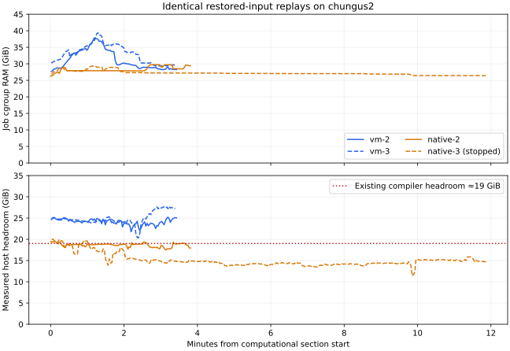

# Matched native/VM CI replay on chungus2, 7 November 2026

The matched inputs confirm lower CPU and disk-read cost for the supported native
backend. They **do not establish a wall-clock speedup or a proportional increase
in runner capacity under the current memory gate**. Completed native passes took
3m41s–3m50s, compared with 3m25s–3m27s for the normal-cache VM controls. A third
native pass was stopped after ten minutes without phase progress at the RAM gate.

The approximately 8–10 GiB difference in charged peaks substantially overstates
the difference after discounting clean host file cache. This qualifies the
optimistic impression from the earlier [different-PR production trial](../../docs/evidence/native-runner-production-trial-20261107.md).
That trial established real Actions compatibility; its 5m25s versus 11m08s pair
was not a controlled backend comparison.

## Primary comparison

All four primary attempts used byte-identical restored inputs and no explicit
VM guest-cache purge. The normal VM pressure/reclaim helper stayed enabled; this
is a cache-friendly setup condition, not a guarantee that every guest page
remained resident. The predeclared balanced order was native-2, vm-2, vm-3,
native-3. Different host headroom prevents attributing latency solely to backend.

| Pass | Outcome | Computational wall time | Exact unit RAM peak | Host CPU seconds in body | Host block reads in body | RAM-related compiler wait |
| --- | --- | ---: | ---: | ---: | ---: | ---: |
| native-2 | pass | 3m49.54s | 29.74 GiB | 100.1 | 5.77 GiB | ~131 s |
| vm-2 | pass | 3m26.97s | 37.92 GiB | 248.3 | 26.36 GiB | 0 s |
| vm-3 | pass | 3m24.58s | 39.53 GiB | 239.3 | 31.71 GiB | 0 s |
| native-3 | stopped at RAM gate | **right-censored after 11m53.62s** | 29.71 GiB | observed only; incomplete | observed only; incomplete | ~600 s |

No experimental unit recorded a memory-max, OOM or OOM-kill event. The final pass
is **not** a successful completion or a mathematical failure. It had passed the
build, duplicate/axiom/module-system checks and environment lint, then could not
start the remaining style-lint compiler work. The guard observed no phase
progress for 601 seconds, one waiting compiler, zero running compilers and an
oldest wait of 589 seconds, then stopped only that unregistered instance.
Its supervisor recorded requested stop/exit 143. The nonzero continuation exit
is retained in [all-done.json](results/all-done.json), not hidden as a pass.

The primary native-2 body had 17.5–19.5 GiB of measured headroom, compared with
21.8–25.2 GiB for vm-2 and 20.3–27.8 GiB for vm-3. Native-3 spent much of its time
near 14–15 GiB. The unchanged normal compiler threshold was approximately
19.02 GiB. These differences can reflect background work and backend/cache
reclaimability; this shared-host series does not isolate their causes.



Native's much lower body CPU and block reads are repeatable observations for
this restored-output workload. They were insufficient to guarantee a shorter
completion time: the existing gate waits dominated the native delays. Aggregate
wait seconds are not subtracted from wall time; waits can overlap, and sampling
windows differ. The primary bodies had at most one observed compiler waiter.

## Charged RAM and reclaimability

A whole-unit charge includes clean host file cache that Linux can reclaim.
For the completed runs, the following time averages subtract
`max(0, file - shmem - file_dirty - file_writeback)` from `memory.current`, matching
the existing Fleet measurement model:

| Completed pass | Mean body charge | Mean after clean host-file discount | Sampled peak after that discount |
| --- | ---: | ---: | ---: |
| native-1, extra repeat | 28.86 GiB | 26.69 GiB | 27.72 GiB |
| native-2, primary | 28.31 GiB | 26.60 GiB | 27.64 GiB |
| vm-2, primary | 31.17 GiB | 27.41 GiB | 27.98 GiB |
| vm-3, primary | 33.10 GiB | 29.74 GiB | 30.31 GiB |

The adjusted difference is about **0.7–3.1 GiB in these completed bodies**, rather
than an 8–10 GiB headroom saving implied by raw peaks. This is a proxy, not an
exact irreclaimable working set: it does not subtract all reclaimable kernel
memory or caches that the guest can release cooperatively. Native's approximately
25 GiB tmpfs workspace remains resident with swap disabled even while compiler
invocations wait. Do not add driver RSS to those same mapped workspace pages.

These measurements do not justify assuming that replacing VMs permits more
runners. Keep expansion off; a useful follow-on must demonstrate progress and
throughput under a measured total memory budget. Reducing persistent workspace
RAM is a distinct possible optimization. No new compiler admission requirement
was introduced or tested here.

## Input identity and scope

Every attempted body, including the censored pass, restored the same sealed
10,163,710,151-byte archive, SHA-256
`2d1f9d4bda40c094f9a97fb946c81bf7f3917970adfa4aaa44b31ab8256c8dff`.
Before timing, a manifest covered **914,541 file/symlink entries**, 677,728 unique
file inodes and 47,721,497,047 logical path bytes. Hard links make logical bytes
larger than allocated or resident memory. Each pass matched manifest SHA-256
`f771851cc0aab6eed71882684b1c7a591b9e6326f5f29ee17c938dffc87ced8a`, the tested tree,
and the selected Bash, Python, libc, libstdc++ and bwrap binary hashes.

- Head: `50604014370dfc4f4370dcb5fa0840e9b11c7177`.
- Base: `afa08a3ed16fb167e35de371afb1eb03fbc5913a`.
- Tested integration: `2cf69b19f7fc387b1538812e3999da0edd8cf7fb`.
- Tested tree: `fdcc264d54a81b592314cf22ec2e6ff9c29f74ec`.
- Stock Lean 4.36.0-rc2; no compiler patches or mapping interposers.

The fixture already contains restored build outputs: **zero TauCeti modules
rebuilt** in each pass's successful build phase. This is a cache-restored CI
workload, not the earlier cold 165-module rebuild experiment. Duplicate-declaration
checks cover 26,361 TauCeti and 9,171 dependency modules; axiom/environment lint
use the same four changed modules, and the docstring scan covers 38,861 declarations.
All five completed passes passed the same computational replay checks. This
unregistered offline sandbox replay does not reproduce Actions downloads,
registration or status publication; those were checked separately by the live
trial. No GitHub status or job was created for this comparison.

## Method and additional diagnostics

Each serial pass starts a fresh disposable instance on chungus2's same local
storage. Both use CPU weight 100, a **54 GiB whole-unit cap**, zero host job swap
and the existing host pressure/compiler gate. The VM has 96 vCPUs, 112 GiB virtual
RAM, an 80 GiB sparse disk and default page reporting. Native uses the supported
namespace supervisor and a private 32 GiB tmpfs at the actual Actions work path;
its toolchain stays on disk. OS/image identities and the verified prepared-image
checksum are in [inputs.json](results/inputs.json) and
[image-identity.json](results/image-identity.json). Native's OS derives from that
same prepared Ubuntu image. Kernel/virtualization differences are inherent in
the backend comparison.

The common unregistered launch check required 40 GiB available and 38 GiB disk
space. It does **not** change the production native 52 GiB startup estimate.
Native-1 and native-3 actually started above 52 GiB; native-2 started at 44.6 GiB.
Headroom can change during population. Local unrelated work stayed enabled;
chungus2's Fleet CI/workers remained disabled as found. The filesystem was near
99% occupied, with about 54 GiB free before an overlay; no global cache flush or
host sysctl change was used.

Both backends get identical per-file `fdatasync`/`FADV_DONTNEED` advice for their
own disposable disk toolchain after input verification. This is not a guarantee
of equal physical cache residency across every storage layer. The offline
candidate command clears its environment, uses the same pinned bwrap boundary,
is network isolated and runs the same trusted scripts, scope and drivers.

The initial vm-1 diagnostic explicitly purged its own guest caches after
verification. That was removed for the primary VM controls, with the primary
order recorded before the first native timed body. Both initial diagnostics are
retained rather than pooled with the primary set:

| Additional diagnostic | Wall time | Exact unit peak | Condition |
| --- | ---: | ---: | --- |
| vm-1 | 2m50.10s | 38.76 GiB | explicit guest-cache purge |
| native-1 | 3m41.16s | 30.55 GiB | same native restore; RAM wait in style lint |

Native-1's wait observer covered only the latter part of its body; its roughly
100 recorded RAM-wait seconds are incomplete. Primary wait observations cover
all primary bodies. There was one experimental pressure client during each
primary body. The guard timeout and primary cache conditions are retained in
[protocol.json](results/protocol.json) and
[censored.json](results/native-3/censored.json).

Startup, archive population and exhaustive input verification are outside the
computational timer. They took approximately **3m08s–3m11s native** and
**9m35s–10m11s normal-cache VM**. The expensive manifest pass is absent from normal
CI, so these are setup-plus-verification costs, **not production job latency**.
Raw unit counters are sampled every two seconds, host/wait observations every
five seconds; body CPU/I/O and time averages are sampled approximations.
`MemoryPeak` is exact for the complete unit, including setup/verification.
Block reads select the common root MD device `9:127`, avoiding duplicate sums
across storage layers. Censored body observations end when stop was requested,
excluding teardown from the plotted headroom.

## Cleanup and reproduction

[Cleanup proof](results/cleanup-proof.json) verifies all six main PIDs and service
cgroups gone, private instance filesystems and pressure bridges released, and
**zero remaining CI-slice shmem**. The input archive and local configuration hash
are unchanged. Tauchonki's before/after settings were four runners, workers and
CI enabled, native off, and no drain. The benchmark made no production mutation.
Small metadata and compressed evidence remain; the pre-existing sealed fixture
is retained separately, while experimental overlays and RAM workspaces are removed.

[summary.json](results/summary.json), per-pass input identities, counters, logs,
phase timings, timeout and cleanup records are self-contained for analysis:

```sh
cd experiments/native-vm-matched-20261107
python analyze.py .
uv run --no-project --with matplotlib python plot.py
```

A fresh live replay additionally needs the retained sealed fixture and matching
prepared/native images. `run.py` refuses existing experiment state, runs the
first four passes, and `--finish-warm-controls` runs the final VM/native pair.
`observe.py` records read-only host/wait data; `stall-guard.py` bounds the final
unregistered replay. The recorded stopped replay correctly leaves the
continuation exit nonzero. There is no deployment command in this experiment.
